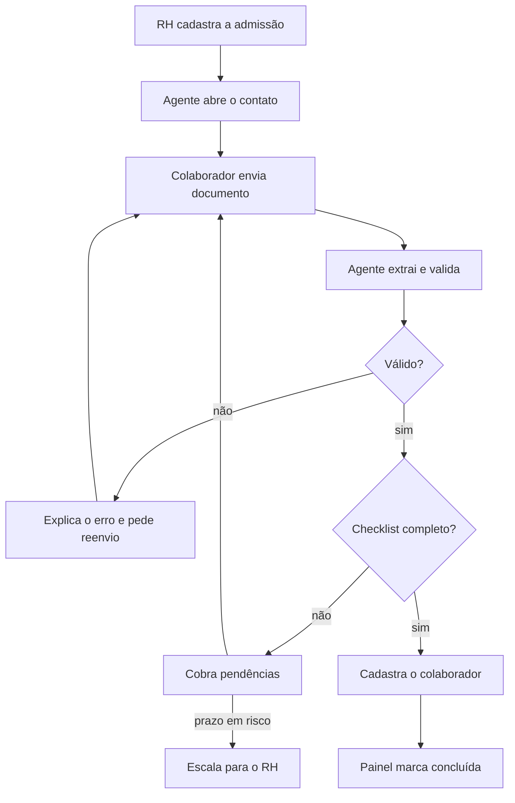
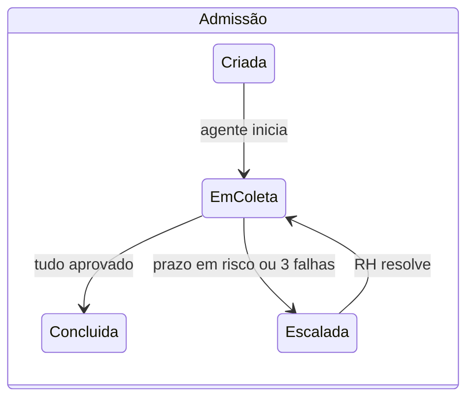
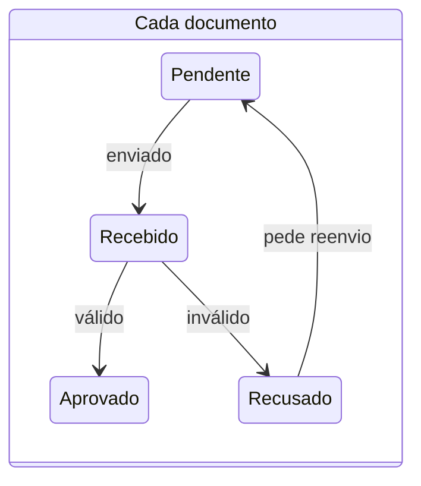
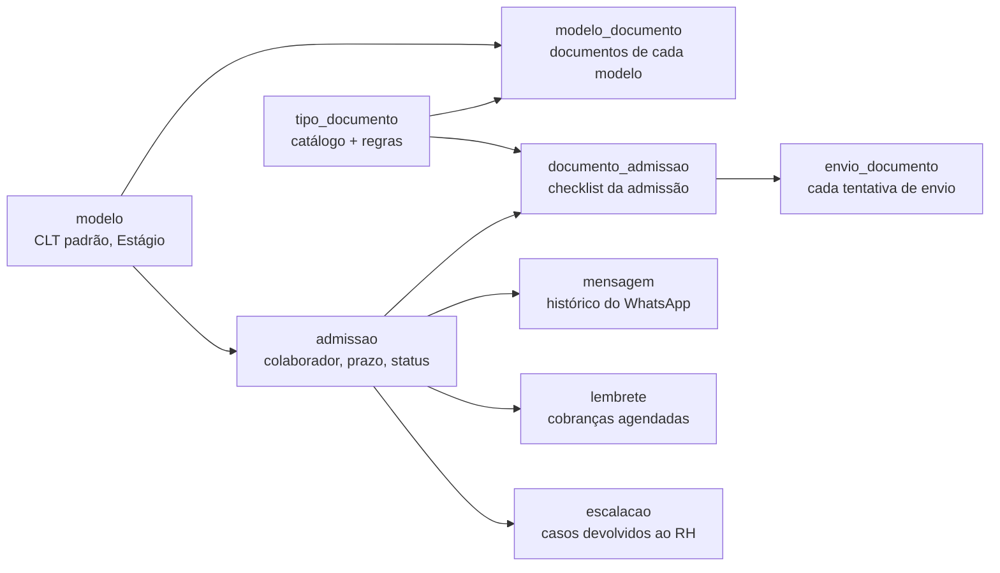

# Agente de Admissão — Desenho do Produto

> Transcrição estruturada do PDF `docs/Agente de Admissão — Desenho do Produto (1).pdf` (07/11/2026, @Marcelo).
>
> **Atualização de 08/11/2026:** o catálogo base continua com os documentos genéricos. Cada empresa monta modelos por
> cargo e acrescenta os documentos específicos do seu negócio (ex.: numa empresa de energia, "Eletricista" pede também
> ASO, NR-10 e NR-35). Documentos com validade continuam sendo cobrados durante o
> vínculo (renovação). A tese completa está em [../tese-de-negocio.md](../tese-de-negocio.md).

---

## 1. Visão geral

Um agente que conduz a admissão de ponta a ponta pelo WhatsApp: coleta, valida e cobra os documentos
até o colaborador estar cadastrado, sem o RH correr atrás de ninguém.

- **Problema.** A admissão é um gargalo de troca de mensagens, conferência manual de fotos e digitação
  de dados. Documentos chegam ilegíveis, incompletos ou fora de prazo, e o RH vira cobrador.
- **Proposta.** O RH cadastra o novo colaborador e escolhe os documentos exigidos. O agente assume o
  contato, extrai e valida cada documento, explica o que está errado, cobra pendências e cadastra o
  colaborador quando tudo está completo. O RH só entra quando o agente escala.
- **Pitch.** *Admissão que se resolve sozinha.*

## 2. Atores

| Ator | Canal | O que faz |
| --- | --- | --- |
| RH | Painel web | Configura catálogo e modelos, cadastra admissões, acompanha status, resolve escalações |
| Novo colaborador | WhatsApp | Recebe as instruções, envia documentos, tira dúvidas sobre o processo |
| Agente | WhatsApp e painel | Conduz a coleta, valida, cobra, escala e cadastra |
| Sistema de destino | API | Recebe o cadastro do colaborador (mock na demo) |

## 3. Configuração pelo RH

O RH define quais documentos o agente pede, escolhendo de um catálogo. **O agente não decide o
checklist; ele o executa.**

**Catálogo de documentos.** Cada tipo de documento traz: campos a extrair, regras de validação e
instrução para o colaborador (o que é e como enviar).

| Documento | Campos extraídos | Regras de validação |
| --- | --- | --- |
| RG ou CNH | Nome, número, data de nascimento, filiação, validade (CNH) | Legível; frente e verso; CNH dentro da validade |
| CPF | Nome, número | Dígito verificador válido; nome igual ao do RG |
| Comprovante de residência | Titular, endereço, data de emissão | Emitido há menos de 90 dias |
| Dados bancários | Banco, agência, conta, titular | Titular igual ao colaborador |
| Declaração de matrícula | Nome, instituição, curso, data | Nome igual ao do RG; data recente |

- **Modelos.** Conjuntos prontos de documentos, como "CLT padrão" e "Estágio".
- **Ajuste por admissão.** Ao cadastrar um colaborador, o RH escolhe um modelo e pode adicionar ou
  remover documentos.
- **Documento personalizado.** O RH pode pedir algo fora do catálogo descrevendo-o em texto. O agente só
  verifica legibilidade e se parece ser o documento pedido, sem extrair campos.

## 4. Fluxo ponta a ponta

*O agente só devolve ao RH o que não consegue resolver.* (2 decisões, 2 laços)

Documento inválido volta para o colaborador com o motivo; pendência vira cobrança. O RH só entra quando
o prazo fica em risco ou o mesmo documento falha 3 vezes.

## 5. Responsabilidades do agente

O agente é dono da coleta até o cadastro; decisões de contratação e exceções ficam com o RH.

**Faz:**

1. Abrir o processo: apresentar-se, explicar o que vai precisar e até quando.
2. Seguir o checklist definido pelo RH.
3. Receber e identificar cada documento, mesmo fora de ordem.
4. Extrair os dados de cada documento.
5. Validar qualidade, consistência entre documentos e validade.
6. Explicar o problema de forma específica e pedir reenvio.
7. Cobrar pendências, com intensidade crescente conforme o prazo se aproxima.
8. Escalar para o RH quando não consegue resolver sozinho.
9. Cadastrar o colaborador no sistema de destino quando tudo estiver completo.
10. Manter o status visível no painel do RH.

**Não faz:**

- Decidir contratação ou aprovar sozinho um documento suspeito.
- Responder sobre salário, benefícios ou contrato; encaminha ao RH.
- Assinar contrato ou agendar exame admissional (evolução futura).

## 6. Estados da admissão e de cada documento

*A admissão só fecha quando todos os documentos são aprovados.*

Um documento recusado volta para pendente com o motivo; a admissão só vai para concluída quando todos os
documentos do checklist estão aprovados.

## 7. Validação, cobrança e escalação

**O LLM extrai e explica; as regras de validação rodam em código, para o resultado ser previsível.**

**Validação em três camadas:**

1. **Qualidade:** imagem legível, documento inteiro, tipo correto.
2. **Regras do documento:** as do catálogo (validade, data de emissão, dígito verificador).
3. **Consistência cruzada:** nome, CPF e data de nascimento iguais entre os documentos.

Toda recusa vem com o motivo e o que fazer, por exemplo: *"o comprovante é de março; preciso de um
emitido nos últimos 90 dias"*.

**Cobrança (proposta, a validar com o time):**

| Momento | Ação do agente |
| --- | --- |
| 24 h sem resposta | Lembrete leve listando o que falta |
| Metade do prazo | Lembrete com a data limite |
| 2 dias antes do início | Lembrete firme + aviso ao RH no painel |
| Prazo estourado | Escala para o RH |

**Escalação para o RH quando:**

- O prazo está em risco.
- O mesmo documento falha 3 vezes.
- Há inconsistência entre documentos que o colaborador não resolve.
- Há suspeita de adulteração.
- O colaborador pergunta algo fora do escopo.

A escalação leva o motivo, o histórico da conversa e o que já foi coletado.

## 8. Painel do RH e telas

O painel mostra, em uma tela, quem está travado e por quê.

- **Configuração:** catálogo de documentos e modelos.
- **Nova admissão:** nome, WhatsApp, cargo, data de início, modelo e ajustes.
- **Lista de admissões:** status, documentos pendentes, dias até o início, risco de prazo.
- **Detalhe da admissão:** documentos com status e dados extraídos, histórico da conversa.
- **Fila de escalações:** casos que o agente devolveu, com motivo e ação sugerida.

O colaborador não tem tela: tudo acontece no WhatsApp. O RH usa um painel web com cinco telas.

**Mock-up do PDF.** À esquerda, a conversa no WhatsApp ("Assistente de Admissão"):

> **Agente:** Oi, Ana! Vou cuidar da sua admissão. Preciso de 5 documentos até sexta.
> **Ana:** [foto do RG]
> **Agente:** A foto cortou a data de nascimento. Pode reenviar com o RG inteiro?
> **Ana:** [foto do RG]
> **Agente:** RG aprovado. Faltam 4: CPF, comprovante, banco e declaração de matrícula.

À direita, a lista do painel ("Admissões — 2 em coleta · 1 escalada · 1 concluída"):

| Colaborador | Modelo | Início | Pendentes | Status |
| --- | --- | --- | --- | --- |
| Ana Souza | Estágio | em 3 dias | 4 de 5 | Em coleta |
| Bruno Lima | CLT padrão | em 2 dias | 3 de 4 | Escalada |
| Diego Rocha | Estágio | em 6 dias | 5 de 5 | Em coleta |
| Carla Mendes | CLT padrão | em 9 dias | 0 de 4 | Concluída |

Card de escalação: *Bruno Lima · comprovante recusado 3 vezes · início em 2 dias · ver conversa.*

| Usuário | Tela | O que tem |
| --- | --- | --- |
| RH | Lista de admissões (início) | Resumo por status, tabela com prazo e pendências, botão de nova admissão |
| RH | Nova admissão | Nome, WhatsApp, cargo, data de início, modelo e ajuste dos documentos |
| RH | Detalhe da admissão | Checklist com status de cada documento, dados extraídos, imagem enviada, conversa completa |
| RH | Escalações | Casos devolvidos pelo agente, com motivo e ações: aprovar manualmente, pedir de novo, falar com o colaborador |
| RH | Catálogo e modelos | Tipos de documento com instruções; modelos com seus documentos |
| Colaborador | WhatsApp | Boas-vindas com checklist e prazo, confirmação de cada documento, recusa com motivo, lembretes, mensagem de conclusão |

## 9. Modelagem de dados

Nove tabelas: três de configuração do RH, uma de admissão no centro e cinco de acompanhamento. Os status
batem com os estados do fluxo.

| Tabela | Campos principais | Observação |
| --- | --- | --- |
| tipo_documento | id, nome, instrucao_colaborador, campos_extracao (json), regras_validacao (json) | Catálogo; as regras são lidas pelo validador em código |
| modelo | id, nome | Ex.: CLT padrão, Estágio |
| modelo_documento | modelo_id, tipo_documento_id | Ligação N:N entre modelo e tipo de documento |
| admissao | id, nome, whatsapp, cargo, data_inicio, modelo_id, status, id_externo, criada_em, concluida_em | status: criada, em_coleta, escalada, concluida; id_externo vem do sistema de destino |
| documento_admissao | id, admissao_id, tipo_documento_id (nulo se personalizado), descricao_personalizada, status, tentativas, motivo_recusa, dados_extraidos (json) | O checklist copiado do modelo e ajustado; status: pendente, recebido, aprovado, recusado |
| envio_documento | id, documento_admissao_id, arquivo_url, resultado, motivo, criado_em | Histórico de cada tentativa; base da regra de 3 falhas |
| mensagem | id, admissao_id, direcao (entrada ou saída), texto, midia_url, criada_em | Conversa exibida no detalhe da admissão |
| lembrete | id, admissao_id, nivel (leve, prazo, firme), agendado_para, enviado_em | Lido pelo scheduler de cobrança |
| escalacao | id, admissao_id, documento_admissao_id (opcional), motivo, status (aberta ou resolvida), resolucao, criada_em | Alimenta a fila de escalações do painel |

Ao criar uma admissão, os documentos do modelo são copiados para `documento_admissao`. Assim o RH ajusta
uma admissão sem alterar o modelo.

## 10. Escopo do MVP e roteiro da demo

O MVP prova o loop completo com poucos documentos; o resto vira slide de evolução.

| Entra no MVP | Fica para depois |
| --- | --- |
| Catálogo com RG/CNH, CPF, comprovante, dados bancários, declaração de matrícula | Documento personalizado (a decidir) |
| Modelos "CLT padrão" e "Estágio" com ajuste por admissão | Validação de autenticidade via API externa (ex.: Serpro Datavalid) |
| Coleta, validação, cobrança e escalação pelo WhatsApp | Agendamento de exame admissional |
| Cadastro em sistema de destino mock | Integração real com folha e eSocial |
| Painel do RH com lista, detalhe e escalações | Assinatura de contrato |

**Roteiro da demo (cerca de 3 min):**

1. O RH cadastra um estagiário, escolhe o modelo "Estágio" e adiciona um documento.
2. O agente inicia a conversa no WhatsApp.
3. O colaborador envia um RG borrado; o agente explica o problema e pede outro.
4. Envia um comprovante antigo; o agente recusa com o motivo.
5. O colaborador para de responder; o agente cobra sozinho (tempo acelerado) e alerta o RH.
6. Com tudo completo, o agente cadastra o colaborador e o painel fica verde.

## 11. Decisões em aberto

- [ ] Documento personalizado entra no MVP?
- [ ] Cadência de cobrança: a proposta acima está boa?
- [ ] Limite de tentativas antes de escalar: 3 está bom?
- [ ] Dados bancários entram como documento (foto) ou como formulário na conversa?
- [ ] O colaborador pode tirar dúvidas gerais do processo, ou o agente só coleta?
- [ ] Qual sistema de destino simular no mock (formato do cadastro)?
