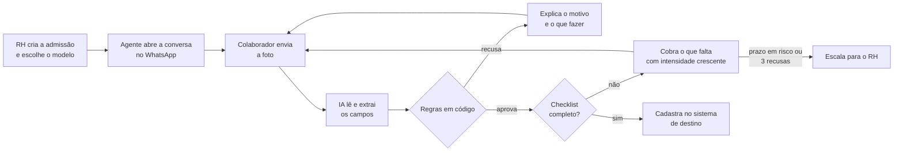
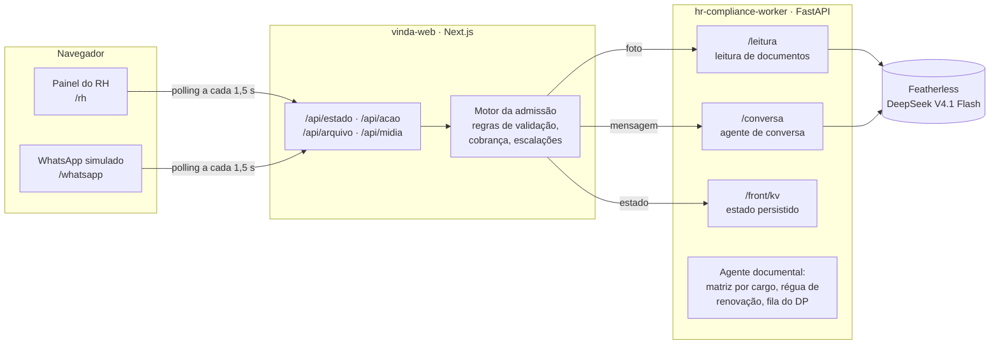

# vinda · Project description

***Admissão que se resolve sozinha. E documentos que continuam em dia.***

A **vinda** é um agente de IA para RH e departamento pessoal que conduz a coleta de documentos do novo colaborador,
do convite ao cadastro. O agente pede cada documento pelo WhatsApp, lê a foto, confere as regras, recusa explicando o
motivo e o que fazer, cobra o que falta e só devolve ao RH as exceções. Cada empresa monta seus modelos de admissão por
cargo a partir de um catálogo base e acrescenta os documentos do seu negócio, como ASO, NR-10 e NR-35 numa empresa de
energia. Documentos com validade voltam a ser cobrados durante o vínculo.

| | |
|---|---|
| **Produto no ar** | [vinda-web.onrender.com](https://vinda-web.onrender.com): landing, painel do RH em [`/rh`](https://vinda-web.onrender.com/rh) e WhatsApp simulado em [`/whatsapp`](https://vinda-web.onrender.com/whatsapp) |
| **API do agente** | [hr-compliance-worker.onrender.com/docs](https://hr-compliance-worker.onrender.com/docs) |
| **Código** | [github.com/viniciuslidington/HR-Compliance-AI](https://github.com/viniciuslidington/HR-Compliance-AI) |
| **Visão de negócio** | [tese-de-negocio.md](tese-de-negocio.md) · [pesquisa de mercado](pesquisa/relatorio-admissao.md) |

## 1. O problema

- O Brasil fez **26,7 milhões de admissões CLT** nos 12 meses até julho de 2026, cerca de 73 mil por dia
  ([Novo Caged](https://www.gov.br/trabalho-e-emprego/pt-br/acesso-a-informacao/acoes-e-programas/programas-projetos-acoes-obras-e-atividades/estatisticas-trabalho/novo-caged/2026/julho/sumario-executivo_julho-de-2026.pdf)).
- Cada admissão exige uma série de documentos que chegam ilegíveis, incompletos, vencidos ou fora de ordem. O RH vira
  cobrador: troca mensagens, confere fotos à mão e digita dados. Em média, o time de RH tem duas pessoas e acumula o
  departamento pessoal na maioria das empresas.
- O prazo é legal: o registro do empregado no eSocial vence na véspera do primeiro dia, sob multa de **R$ 3.000 por
  empregado** sem registro (CLT, art. 47).
- Depois da admissão, o problema continua. Sem NR-35 em dia, ninguém sobe em altura; sem declaração de matrícula
  atualizada, o estágio vira vínculo de emprego.

As ferramentas atuais de admissão digital recebem os documentos num portal, conferem com OCR ou IA e deixam a validação,
a cobrança e a correção para o RH. Ferramentas de saúde e segurança do trabalho avisam o vencimento, mas não conduzem a
renovação.

## 2. A solução

A vinda assume a pendência documental de ponta a ponta. O RH configura **o que** pedir; o agente cuida de **conseguir**.



### Funcionalidades

**Painel do RH** (`/rh`)
- Lista de admissões com status, documentos recebidos, dias até o início e alertas de prazo.
- Nova admissão: nome, WhatsApp, cargo, data de início, modelo e ajuste dos documentos.
- Detalhe da admissão: checklist com o status de cada documento, dados extraídos, imagem enviada e a conversa completa.
- Fila de escalações com o motivo e as ações aprovar manualmente, pedir de novo ou falar com o colaborador.
- Catálogo de documentos e modelos de admissão.

**Colaborador no WhatsApp** (`/whatsapp`, simulado)
- Boas-vindas com o checklist e o prazo.
- Envio de fotos, confirmação de cada documento aprovado e recusa com motivo e instrução.
- Perguntas em texto livre respondidas pelo agente com base no estado real da admissão; o que foge do escopo vai para o
  RH.

**Agente**
- Identifica qual documento foi enviado, mesmo fora de ordem.
- Valida em três camadas: **qualidade** (legível, documento certo), **regras do documento** e **consistência** entre
  documentos.
- Cobra com intensidade crescente: lembrete após 24 h sem resposta, na metade do prazo, lembrete firme a 2 dias do
  início e escalação com o prazo estourado.
- Escala para o RH quando o mesmo documento é recusado 3 vezes, o prazo estoura, há inconsistência, suspeita ou pergunta
  fora do escopo.
- Conclui a admissão e registra o cadastro no sistema de destino quando tudo está aprovado.

### Catálogo e modelos

| Documento | Regras em código |
|---|---|
| RG ou CNH | Legível, frente e verso; CNH dentro da validade |
| CPF | Dígito verificador válido; nome igual ao do documento de identidade |
| Comprovante de residência | Emitido há menos de 90 dias |
| Dados bancários | Titular igual ao colaborador |
| Declaração de matrícula | Nome igual ao do documento de identidade; data recente |
| ASO | Legível; nome igual; resultado apto; realizado há menos de 12 meses |
| Certificado NR-10 | Legível; nome igual; carga horária mínima de 40 h; válido por 24 meses |
| Certificado NR-35 | Legível; nome igual; carga horária mínima de 8 h; válido por 24 meses |

Modelos prontos: **CLT padrão** (RG/CNH, CPF, comprovante, dados bancários), **Estágio** (RG/CNH, CPF, comprovante,
matrícula) e **Eletricista** (básicos + ASO, NR-10 e NR-35), este como exemplo de uma empresa de energia.

## 3. Como a IA é usada

O modelo de linguagem **lê e explica**; o **código decide**.

| Tarefa | Quem faz |
|---|---|
| Transcrever a foto | Modelo de visão |
| Identificar o documento e extrair os campos em um schema | Modelo de texto |
| Conferir validade, datas, dígitos verificadores, carga horária, titularidade e consistência | Código |
| Aprovar, recusar ou escalar | Código |
| Responder às perguntas do colaborador | Modelo de texto, com o estado real da admissão |

**Salvaguardas**
- **Leitura em dois passos:** o modelo de visão só transcreve; o modelo de texto extrai os campos a partir da
  transcrição.
- **Guarda de fidelidade:** todo campo extraído precisa aparecer literalmente na transcrição; o que não aparece é
  descartado.
- **Conteúdo não confiável:** o texto vindo da imagem é marcado como dado, não como instrução. O modelo não tem
  ferramenta de aprovar, então um texto malicioso na foto não aprova documento nenhum.
- **A conversa não altera o estado:** o agente de conversa orienta e encaminha ao RH, mas não aprova documentos nem
  aceita dados digitados no lugar da foto.
- **Falha não vira recusa:** se o modelo não responder, o colaborador é avisado e a tentativa não conta para a escalação.
- **Dado de saúde:** do ASO, guarda-se só nome, CPF, data e resultado (apto ou inapto); a transcrição da imagem não é
  gravada.

Modelo em produção: `deepseek-ai/DeepSeek-V4.1-Flash-1017` na Featherless, para visão e texto. Medimos cerca de
**3.500 tokens por documento lido**, o que leva o custo de uma admissão completa, com conversa e mensagens, a perto de
**R$ 1**.

## 4. Arquitetura



- **vinda-web (Next.js 16, React 19, TypeScript).** O painel do RH e o WhatsApp simulado compartilham um único estado,
  mantido pelo servidor do Next. Cada ação é serializada, aplicada pelo motor da admissão, versionada e gravada no
  worker; as duas telas acompanham por polling. O token do worker fica só no servidor.
- **hr-compliance-worker (Python 3.12, FastAPI).** Leitura de documentos (`/leitura`), agente de conversa
  (`/conversa`) e persistência do estado do painel (`/front/kv`), com SQLite e armazenamento de arquivos por hash em
  disco persistente. O worker também traz o agente documental de documentos regulados: matriz de exigências por cargo,
  régua de renovação (aviso, lembrete, lembrete firme, impedimento), fila do DP com prioridades e card de impedimento.
- **Deploy:** Render, com os dois serviços descritos em `render.yaml`.
- **Design system próprio:** tokens em `design-system/`, usados por toda a interface.

## 5. Demonstração

Imagens fictícias, em nome de Rafael Costa Mendes, ficam em
[`/demo/`](https://vinda-web.onrender.com/demo/rg.png) no site.

1. Em `/rh`, crie uma admissão para **Rafael Costa Mendes** com o modelo **Eletricista (NR-10 e NR-35)**. O agente
   envia as boas-vindas.
2. Em `/whatsapp`, envie as fotos nesta ordem:

| Arquivo | O que acontece |
|---|---|
| `rg-borrado.png` | Recusa: ilegível, pede outra foto |
| `rg.png` | Aprovado |
| `cpf.png` | Aprovado |
| `comprovante-antigo.png` | Recusa: emitido há mais de 90 dias |
| `comprovante.png` | Aprovado |
| `banco.png` | Aprovado |
| `aso.png` | Aprovado |
| `nr35-vencido.png` | Recusa: vencido (mais de 24 meses) |
| `nr35.png` | Aprovado |
| `nr10.png` | Aprovado; admissão concluída |

3. O painel atualiza sozinho. Variações: `banco-outro-titular.png` (titular diferente) e `nr10-carga-baixa.png` (carga
   horária abaixo do mínimo). Três recusas do mesmo documento abrem uma escalação em `/rh/escalacoes`.
4. Na barra **Demo** do painel, avance o tempo para ver a cobrança: lembrete após 24 h, na metade do prazo, 2 dias antes
   do início e escalação com o prazo estourado.

## 6. Modelo de negócio

| Plano | Mensalidade | Admissões incluídas | Destaques |
|---|---|---|---|
| Grátis | R$ 0 | 3 por mês | Catálogo base, 1 modelo |
| Essencial | R$ 149 | 15 por mês | 3 modelos; renovação a R$ 0,50 por colaborador/mês |
| Profissional | R$ 449 | 60 por mês | Documentos específicos da empresa, integração com folha, 100 colaboradores em renovação |
| Corporativo | A partir de R$ 1.500 | Negociado | Vários CNPJs, integrações sob medida, SLA |

A R$ 10 por admissão, entre a ferramenta de admissão (R$ 2,49 a R$ 6) e o contador (R$ 150), o mercado endereçável é de
**R$ 267 milhões por ano** (TAM), **R$ 181 milhões** nos setores de alto giro (SAM) e **R$ 1,9 milhão** no terceiro ano
(SOM, 400 clientes). Business Model Canvas, planos completos e a conta do mercado estão na
[tese de negócio](tese-de-negocio.md).

## 7. Qualidade

| Parte | Testes |
|---|---|
| `web/` (Vitest + Testing Library) | 252 testes em 29 arquivos |
| `worker/` (pytest) | 238 testes, incluindo testes de leitura com inferência real |

Os testes cobrem as regras de validação, o motor da admissão, as telas, a leitura com guarda de fidelidade, a conversa,
a régua de renovação e a API.

## 8. Escopo atual

- O canal de WhatsApp é uma simulação na própria aplicação. A integração com a plataforma oficial passa por um provedor
  (BSP), com templates de utilidade e link seguro para documentos e dados bancários.
- O sistema de destino é simulado: recebe o cadastro concluído e devolve um identificador externo. O próximo passo é a
  integração com sistemas de folha.
- A régua de renovação e a fila do DP estão na API do worker; a próxima etapa é trazê-las para o painel.
- O agente não detecta falsificação de documentos: sinais de suspeita escalam para o RH, e a validação de autenticidade
  (Serpro Datavalid, biometria) entra como complemento.

## 9. Como executar

Instruções completas no [README do repositório](../../README.md).

```bash
cd web && npm ci && npm run dev                       # http://localhost:3000, estado em memória e leitor simulado
cd worker && uv sync && uv run uvicorn api:app_do_ambiente --factory --reload   # API com IA (exige FEATHERLESS_API_KEY)
cd web && WORKER_URL=http://127.0.0.1:8000 npm run dev   # painel ligado ao worker local
```
